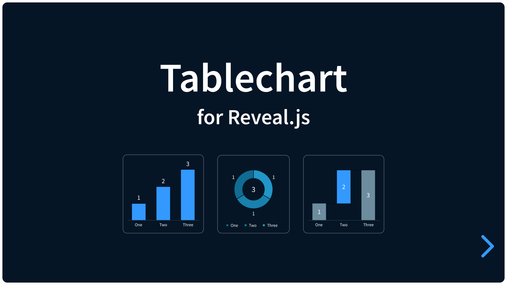

# Tablechart for Reveal.js

[]()

Simple charts in a Reveal.js presentation.

A plugin for [Reveal.js](https://revealjs.com) that makes easy charts. Can't get it very much simpler. Use it for areas, bars, columns, donuts, lines, waterfall and scatter charts. In its core is the regular version of [Tablechart](https://martinomagnifico.github.io/tablechart/). Accessibility first. This plugin optimises it for Reveal slide use. 

[](https://martinomagnifico.github.io/reveal.js-tablechart/demo/demo.html)


## Install

Download the `plugin/tablechart` folder, and add it to your presentation:

```html
<script src="plugin/tablechart/tablechart.js"></script>
<script>
	Reveal.initialize({
		plugins: [Tablechart]
	});
</script>
```

The plugin loads its stylesheet by itself. To load it yourself, for example to
change it, set `cssautoload: false` and link `plugin/tablechart/tablechart.css`.

Or install it with npm:

```sh
npm install reveal.js-tablechart
```

```js
import Reveal from "reveal.js";
import Tablechart from "reveal.js-tablechart";
import "reveal.js-tablechart/tablechart.css";

Reveal.initialize({
	plugins: [Tablechart]
});
```

## A chart

A chart is a `figure` with `data-chart` and a table in it:

```html
<section>
	<figure data-chart="column">
		<figcaption><b>Apples picked</b><br><span>thousands</span></figcaption>
		<table>
			<tbody>
				<tr><th>Spring</th><td>58</td></tr>
				<tr><th>Summer</th><td>72</td></tr>
				<tr><th>Autumn</th><td>70</td></tr>
			</tbody>
		</table>
	</figure>
</section>
```

The value of `data-chart` is the type of chart. See each type in the demo:

- [Column](https://martinomagnifico.github.io/reveal.js-tablechart/demo/charts/column.html): `column`, the default
- [Bar](https://martinomagnifico.github.io/reveal.js-tablechart/demo/charts/bar.html): `bar`
- [Line](https://martinomagnifico.github.io/reveal.js-tablechart/demo/charts/line.html): `line`
- [Area](https://martinomagnifico.github.io/reveal.js-tablechart/demo/charts/area.html): `area`
- [Waterfall](https://martinomagnifico.github.io/reveal.js-tablechart/demo/charts/waterfall.html): `waterfall`
- [Donut](https://martinomagnifico.github.io/reveal.js-tablechart/demo/charts/donut.html): `donut`
- [Scatter and bubble](https://martinomagnifico.github.io/reveal.js-tablechart/demo/charts/scatter.html): `scatter`

For everything a table can say, see
[Data](https://martinomagnifico.github.io/tablechart/data.html) and the
chart types on the Tablechart site.

## When a chart is shown

A chart builds up, animates, when you get to the slide it is on. If it built while the slide was still coming in, it would be half done before you could see it. So Tablechart waits until the slide has stopped moving. When you leave the slide, the chart is reset, so it builds again when you come back.

### In a fragment

If the figure is a fragment, or is inside one, the chart builds when that
fragment is shown:

```html
<figure class="fragment" data-chart="column">…</figure>
```

### In an element that animates in

A chart can be inside an element that animates in, such as a block that slides in
with [Appearance](https://github.com/martinomagnifico/reveal.js-appearance). The
chart then builds when that element is halfway in. You do not need to set
anything. To choose another moment, add `data-entrance-at` to the element.

This works with any plugin that gives the entrance signal of
[reveal.js-plugintoolkit](https://github.com/martinomagnifico/reveal.js-plugintoolkit).
If a plugin does not give it, Tablechart waits until the CSS animation of the
element is halfway. Add `data-chart-entrance` to the figure to choose another
moment, from `0` (as soon as the element starts to move) to `1` (when it is in).

## Steps

Add `data-fragment` to a row to show it on a step of its own. A row without it is
there from the start, so a chart can start with its totals.

```html
<tr data-fragment><th>Apples</th><td>128</td></tr>
<tr data-fragment><th>Pears</th><td>94</td></tr>
```

- Rows with the same `data-fragment-index` arrive together. The index is
  Reveal's own, so the steps of a chart can take turns with other fragments on
  the slide.
- `data-fragment` on the figure gives every row a step.
- `data-fragment` on a column header shows that line, or those bars, on a step of
  their own.
- An annotation arrives with the last step of the rows it is about.
  `data-fragment` on the annotation gives it a step of its own.

The rows ask with an attribute, not with the `fragment` class: Reveal hides
elements with that class, and the table must stay readable for screen readers.

## Several charts on a slide

`data-chart-sequence` on a slide, or on an element around the charts, plays them
one after the other, in the order they are in the page:

```html
<section data-chart-sequence="after" data-chart-delay="200">
	<figure data-chart="column">…</figure>
	<figure data-chart="column">…</figure>
</section>
```

| `data-chart-sequence` | Plays |
| --- | --- |
| `together` | every chart at once. This is the default. |
| `delay` | each chart `data-chart-delay` milliseconds after the one before it started |
| `after` | each chart once the one before it has finished, `data-chart-delay` milliseconds later |

The `sequence` and `sequencedelay` options set this for the whole presentation.

If the charts are inside elements that animate in, such as cards animated by
Appearance, the elements come in first. Once they are all in, the charts play one
after the other. A chart waiting its turn in such an element shows its caption and
key, and only its marks wait.

Without a sequence, each chart in such an element builds when its own element is
shown, so the animations of the elements set the timing.

## Markdown

With Reveal's Markdown plugin, add `data-chart` to a table with an element
comment after it. A paragraph that starts with `: ` is the title:

```markdown
: **Apples picked**

| Season | Apples |
| --- | --- |
| Spring | 58 |
| *Summer* | 72 |
| Autumn | 70 |
<!-- .element: data-chart="column" -->
```

- A name in **bold** in the first column makes the row a total.
- A name in *italics* shows the row on a step of its own. Reveal's
  `<!-- .element: class="fragment" -->` in a cell does the same, and can set
  `data-fragment-index`.
- In the header, a name in bold is highlighted, and a name in italics arrives on
  a step of its own.
- A list after the table is the annotations, such as `- bracket from=2 to=4: +24%`.

## Translation

The plugin works with
[Internation](https://github.com/martinomagnifico/reveal.js-internation). Add
`data-chart-keys` to a figure, and Internation translates the names in the chart
like other text on the slide. The numbers change with the language. Two charts
on the same slide need different keys; on different slides they may be the same.

If Internation uses another attribute than `data-i18n`, the plugin uses that one
too. See
[Translation](https://martinomagnifico.github.io/tablechart/features/translation.html).

## Print

When the presentation is printed, with `?print-pdf`, every chart is shown whole,
without steps.

## Options

The options go in `tablechart` in the Reveal.js settings:

```js
Reveal.initialize({
	tablechart: {
		sequence: "together",
		legend: false
	},
	plugins: [Tablechart]
});
```

| Option | Default | Sets |
| --- | --- | --- |
| `sequence` | `"together"` | How the charts on a slide follow each other: `together`, `delay` or `after` |
| `sequencedelay` | `0` | The time between two charts in a sequence, in milliseconds |
| `buildonload` | `true` | Builds the charts on the slide that the presentation opens with, also after a reload. If `false`, they are shown immediately |
| `animate` | `true` | If `false`, charts are shown immediately, without animation and steps |
| `cssautoload` | `true` | Loads the stylesheet of the plugin |
| `csspath` | `""` | Where the stylesheet is, if it is not next to the plugin |

All other options are the same as in Tablechart. See
[Options](https://martinomagnifico.github.io/tablechart/reference/options.html).

## Styling

Charts use the text colour of the slide. In a presentation, the plugin sets a
few things differently from Tablechart:

- The text of a chart is smaller, `0.34em`, because the text of a slide is large.
  `--tablechart-font-size` changes it.
- The background colour of a chart is that of its slide (`data-background-color`),
  or else that of the presentation. If a chart has its own `--tablechart-surface`,
  that colour is also its background.
- A legend has a thin box around it.

For colours, light and dark slides and all CSS variables, see
[Styling](https://martinomagnifico.github.io/tablechart/styling/index.html).

## License

MIT licensed. Copyright © 2026 Martijn De Jongh (Martino).
